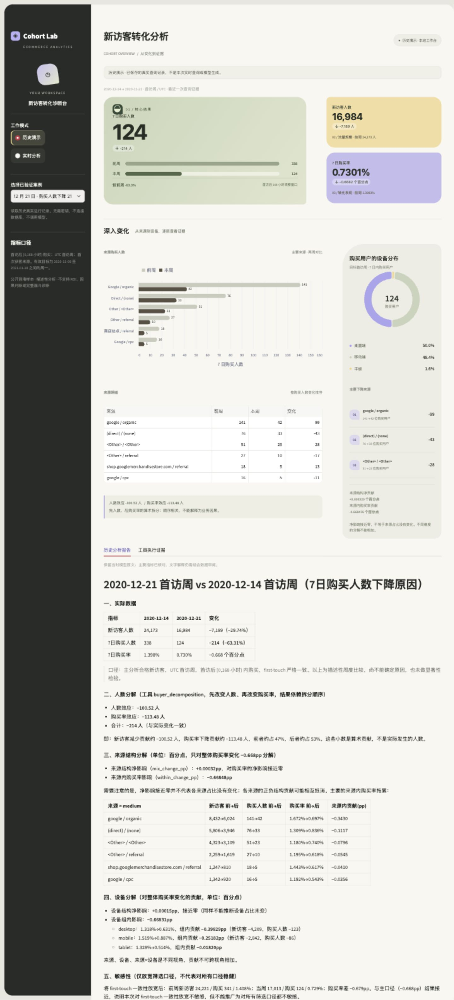

# 电商新访客转化诊断 Agent

基于 Google GA4 电商公开混淆样本，分析某个首访周的新访客在首次访问后 7 日内购买人数的变化。使用 SQL 完成指标计算，大模型通过受约束的工具调用查询结果并回答追问。



## 分析案例

2020-12-21 首访周相较前一周：

| 指标 | 前周 | 本周 |
|---|---:|---:|
| 新访客人数 | 24,173 | 16,984 |
| 7 日购买人数 | 338 | 124 |
| 7 日购买率 | 1.3983% | 0.7301% |

购买人数减少 214 人（63.3%）。按先人数、后购买率的顺序拆解，规模效应约为 −100.52 人，购买率效应约为 −113.48 人；结果与拆分顺序相关。

进一步拆解整体购买率变化：来源结构净贡献约 +0.000320 个百分点，来源内购买率贡献约 −0.668476 个百分点。结构净贡献接近零不代表各来源占比没有变化。上述结果是描述性算术分解，不能证明业务原因。

## 功能与实现

- BigQuery 导出事件，MySQL 建立每用户一行的首访视图；处理重复首访、时间一致性和观察期不足问题。
- `compare_weeks` 查询目标首访周及前周；`diagnose_week` 补充来源、设备、交叉分组及敏感性分析。
- DeepSeek Function Calling：固定工具白名单、日期参数校验、只读数据库账号；每次提问最多 4 轮模型请求及 4 次工具调用。
- 支持连续追问，记录工具结果与用量；Streamlit 提供历史演示与实时查询。
- 不允许模型执行自由生成的 SQL。模型文字仍需结合查询记录审阅。

## 快速体验（无需数据库或 API 密钥）

建议使用 Python 3.12，在项目根目录执行：

```bash
python3 -m venv .venv
source .venv/bin/activate
python -m pip install -r agent/requirements.txt
python -m streamlit run agent/web_app.py --server.address 127.0.0.1
```

浏览器打开终端输出的本机地址。默认“历史演示”读取本仓库两份经过筛选的历史汇总记录，不调用模型、不产生 API 费用。截图对应历史版本，页面文案可能有更新。

## 实时分析与数据准备

实时模式需要本机 MySQL、只读账号和 DeepSeek API 密钥。仅在界面或终端提示中输入密码，不要写入代码或提交至 Git。

1. 数据源：[Google 官方 GA4 电商样本](https://developers.google.com/analytics/bigquery/web-ecommerce-demo-dataset)。按 `sql/bigquery` 查询导出 2020-11-01 至 2021-01-31 的首次访问及购买事件。
2. 在 MySQL 建立 `ecommerce_analysis` 数据库，执行 `sql/mysql/04_create_raw_events.sql`，将导出的记录按字段映射导入。`source_batch` 标明批次，`source_row_no` 为批内唯一序号；其他列及 NULL 标记须与导出结果对应。批次记录数需用 `06_verify_full_import.sql` 对账。仓库不包含原始明细或本地生成的巨量 INSERT 文件，此步骤需要自行导出、映射和导入。
3. 执行 `09_create_new_user_view.sql` 并用 `10_verify_new_user_view.sql` 验收，再执行 `15_create_agent_reader.sql` 创建只读账号。已有表或账号时应核对，不要重复创建或覆盖。
4. 默认连接为 `127.0.0.1:3306`，数据库 `ecommerce_analysis`，账号 `ecommerce_agent`，见 `agent/run_compare.py`。
5. 网页切到“实时分析”，填入本机密码与 API Key，提问：“请分析 2020-12-21 首访周的 7 日购买人数变化。”问题、对话历史和汇总结果会发送给 DeepSeek，并产生 API 费用。

## 指标口径与边界

- 用户是匿名标识，不等同于自然人；来源为首次获客来源。
- 购买窗口为首次访问后的 `[0,168 小时)`；UTC 首访周从周一开始。
- 主分析要求首访与 first-touch 时间一致、无购买先于首访，且整个首访周观察期完整。用户视图共 257,314 人，主分析合格样本 236,194 人。
- Agent 可比较目标周为 2020-11-09 至 2021-01-18 之间的周一。
- 仅包含首访和购买事件，不支持完整漏斗诊断；无广告成本与收入字段，不计算 ROI/ROAS，不宣称因果或业务提升。
- 本项目是个人练习，非生产系统。未部署公网；历史数据与实时业务监控不同。

详见 [指标口径](docs/新访客用户视图口径.md) 与 [分析报告](docs/周度购买下降诊断报告.md)。

## 测试

```bash
python -m unittest discover -s agent -p 'test_*.py' -q
```

覆盖指标计算、日期边界、工具参数、对话与页面流程。离线测试通过不等同于当前数据库和模型接口可用。

## 目录

- `agent/`：查询工具、大模型调用、网页与测试
- `sql/`：取数、建模、质量检查与分析 SQL
- `docs/`：指标口径与案例报告
- `data/`：仅精选的公开样本汇总演示记录和测试数据，不含逐用户明细
- `assets/`：页面截图

原始数据的使用条件以 Google 数据源说明为准。本仓库未附通用开源许可证。
